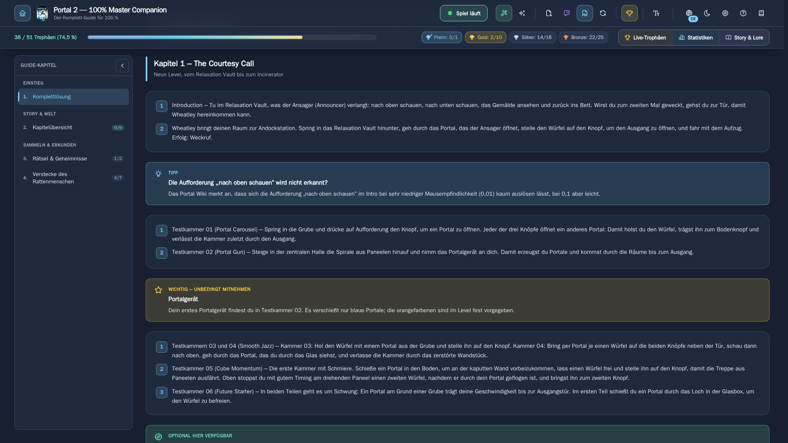
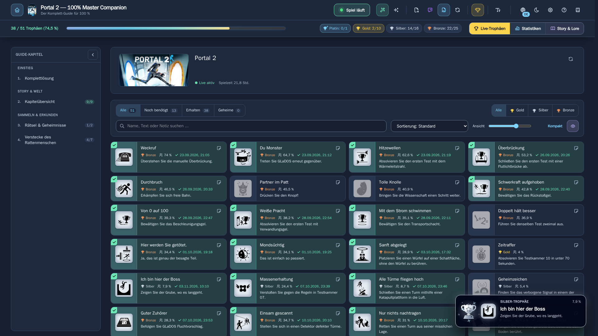
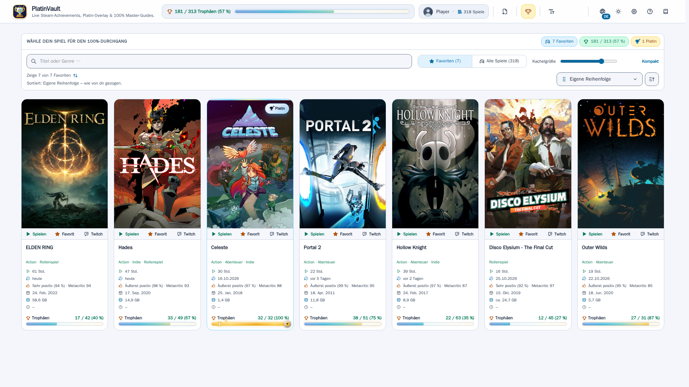
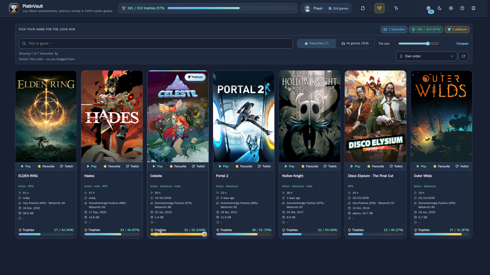
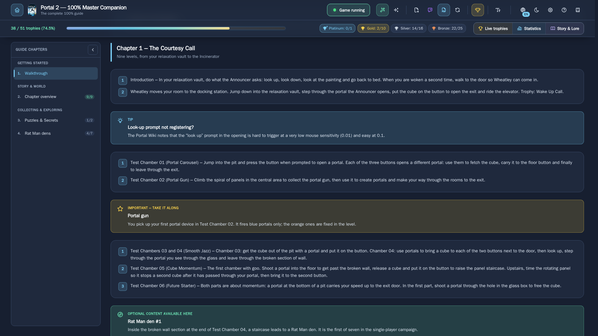
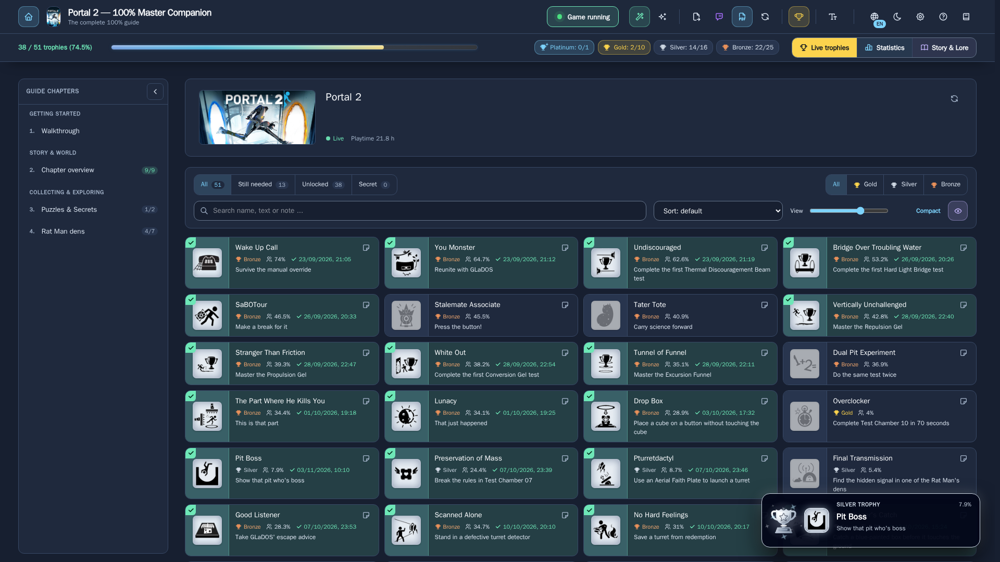
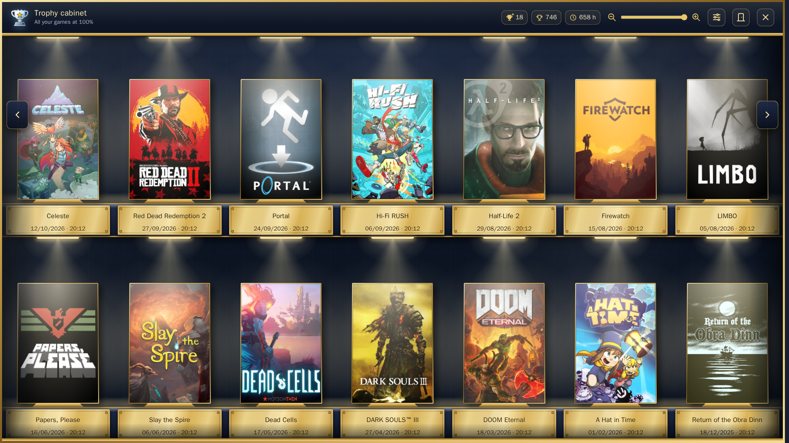

<p align="center"></p>

# PlatinVault

**[Deutsch](#deutsch) · [English](#english) · [Entwicklung / Development](#development)**

<a name="deutsch"></a>
## Deutsch

PlatinVault bringt deine Steam-Erfolge und KI-recherchierte 100%-Guides in eine App.

- **Live-Trophäen:** Jeder Steam-Erfolg erscheint beim Freischalten sofort als Trophäen-Popup mit Klang – im
  Windows-Programm auch als Overlay über dem Spiel.
- **KI-Guide für jedes Spiel:** Komplettlösung in Spielreihenfolge, Verpassbares, Roadmap, Sammelobjekte, Checklisten, die
  sich beim Freischalten selbst abhaken, Rätsel mit verdeckter Lösung, Story & Lore hinter einer Spoiler-Sperre.
- **Bibliothek:** deine ganze Steam-Bibliothek mit Favoriten, Sortierung und Spielstart per Klick.
- **Statistiken** zu jedem Spiel und ein **Trophäenschrank** für alle Spiele mit 100 %.
- Deutsch und Englisch, hell und dunkel. Ein Benutzer, ohne Anmeldung – fürs eigene Heimnetz.

> **Download:** Windows-Installer und Docker-Image stehen unter **Releases**. In den Unraid Community Applications ist
> PlatinVault noch nicht – die Installation mit der Vorlage aus diesem Repository steht unten unter „Unraid“.

### So sieht es aus









<sub>Die Bilder zeigen echte Spiele (Guide, Live-Trophäen und Statistik am Beispiel von Portal 2). Titelbilder, Erfolgsnamen, Seltenheiten und Spielinfos stammen aus dem öffentlichen Steam-Store bzw. den öffentlichen Steam-Schnittstellen und gehören den jeweiligen Rechteinhabern; die Guide-Texte sind in eigenen Worten nach öffentlichen Wikis und Community-Guides geschrieben. Fortschritt, Freischaltzeiten und Spielzeiten sind Beispielwerte. Alle Marken gehören ihren Inhabern; PlatinVault ist weder mit Valve noch mit Steam verbunden.</sub>

### Was du brauchst

**Erfolge und Live-Trophäen**

- Dein Steam-Konto (in der App verbinden) und einen kostenlosen **Steam-Web-API-Key** (steamcommunity.com/dev/apikey).
- Live-Popups beim Freischalten:
  - **Windows-Programm** auf dem Gaming-PC: liest Steam direkt, sonst ist nichts nötig.
  - **Server** (Unraid, Linux, NAS): die **PlatinVault Bridge** auf dem Gaming-PC – fertig eingerichtet als Download in der
    App (Einstellungen → PlatinVault Bridge). Ohne Bridge siehst du deinen Fortschritt, aber nicht live.
- Overlay über dem Spiel: nur mit dem Windows-Programm und nur, wenn das Spiel im randlosen Fenstermodus läuft (nicht im
  exklusiven Vollbild).

**Guides, Erfolgstipps und Story**

- Einen eigenen KI-Zugang: einen **API-Key** von Google Gemini, Anthropic Claude oder OpenAI – **oder dein KI-Abo**
  (PlatinVault gibt dir den Prompt, du fügst ihn im Chat ein und die Antwort zurück in PlatinVault). Ohne KI-Zugang gibt
  es keine Guides.
- Gemini recherchiert im Web nur in einem Google-Projekt mit aktivierter Abrechnung (Stand Oktober 2026). OpenAI
  recherchiert in PlatinVault ohne Websuche.

**Optional**

- Eine Twitch-Entwickler-App (Client-ID und Client-Secret) für Live-Streams zum Spiel und Spielinfos von IGDB.

Eine Datenbank musst du nirgends einrichten: PlatinVault bringt sie mit (eine Datei im Datenordner).

### Windows

1. Unter **Releases** die Datei `PlatinVault-Setup-<Version>.exe` herunterladen und starten.
2. Windows-SmartScreen warnt beim ersten Start, weil die Datei noch nicht digital signiert ist: **Weitere Informationen** →
   **Trotzdem ausführen**.
3. Der Installer richtet alles ein – pro Benutzer, ohne Adminrechte, Datenbank eingebaut. Auf Wunsch startet PlatinVault mit
   Windows und sitzt dann neben der Uhr.

Updates sucht PlatinVault selbst (wie oft, stellst du unter Einstellungen → System → Updates ein) und installiert sie auf
Knopfdruck.

### Unraid

In den Community Applications ist PlatinVault noch nicht. Bis dahin installierst du es mit der Vorlage aus diesem Repository:

1. Im Unraid-Terminal die Vorlage holen:

   ```sh
   wget -O /boot/config/plugins/dockerMan/templates-user/PlatinVault.xml https://raw.githubusercontent.com/sushiflux/PlatinVault/master/unraid/platinvault.xml
   ```

2. Docker-Reiter → **Add Container** → bei *Template* „PlatinVault“ wählen → **Apply**.
3. Die geladene Datei danach wieder löschen: `rm /boot/config/plugins/dockerMan/templates-user/PlatinVault.xml`. Unraid hat
   deine Einstellungen als eigene Vorlage gespeichert; ohne diesen Schritt zeigt „Edit“ später die Standardwerte statt deiner.

Die Vorlage legt den Container an: Port der Weboberfläche und der Appdata-Ordner. Darin liegt alles:
die Datenbank (`platinvault.db`), die automatischen Sicherungen (`backups/`) und deine verschlüsselten Schlüssel – bitte
den ganzen Ordner mitsichern. Eine Datenbank musst du nicht anlegen.

Der Appdata-Ordner steht standardmäßig auf `/mnt/cache/appdata/platinvault`, also direkt auf dem Cache-Pool. Grund: Nutzer
berichten von beschädigten SQLite-Datenbanken, wenn die Datei über die Freigabe-Schicht `/mnt/user/...` (FUSE) erreicht wird
(Erfahrungsberichte im Unraid-Forum, keine offizielle Aussage). Heißt dein Pool anders, passe den Pfad an (z. B.
`/mnt/<poolname>/appdata/platinvault`). Updates holt Unraid über „Update“ im Docker-Reiter, deine Einstellungen bleiben erhalten.

### Linux / Docker

Du brauchst nur Docker mit dem Compose-Plugin (`docker compose version` muss eine Version anzeigen). Alles Weitere –
die Datenbank und die automatischen Sicherungen – steckt im Container.

1. Lege einen Ordner an, z. B. `~/platinvault`, und lade die Dateien aus dem Ordner [`deploy/`](deploy/) dieses Repositorys hinein:
   `docker-compose.yml`, `restore-db.sh` (und, wenn du Port oder Benutzer ändern willst, `.env.example`):

   ```sh
   mkdir -p ~/platinvault && cd ~/platinvault
   wget https://raw.githubusercontent.com/sushiflux/PlatinVault/master/deploy/docker-compose.yml https://raw.githubusercontent.com/sushiflux/PlatinVault/master/deploy/restore-db.sh https://raw.githubusercontent.com/sushiflux/PlatinVault/master/deploy/.env.example
   chmod +x restore-db.sh
   ```
2. Starte alles mit einem Befehl:

   ```sh
   cd ~/platinvault
   docker compose up -d
   ```

   Beim ersten Start lädt Docker das Image und PlatinVault legt seine Datenbank im Ordner `data/` an – du musst nichts eintragen.
3. Öffne `http://<Adresse-deines-Servers>:5233` im Browser.

**Wichtig zu wissen:**

- **Kein Login:** PlatinVault hat bewusst keine Anmeldung. Betreibe es nur im eigenen Heimnetz und stelle den Port nicht
  ins Internet.
- **Benutzer-ID:** Die Daten in `data/` gehören dem Benutzer `PUID:PGID`, Standard `1000:1000` – auf den meisten
  Linux-Systemen der erste normale Benutzer (`id` zeigt deine Zahlen). Anderen Port oder andere Zahlen setzt du in einer
  Datei `.env` neben der Compose-Datei (Vorlage: `.env.example`).
- **Ordner neben der Compose-Datei:** `data/` enthält alles – die Datenbank `platinvault.db`, die Sicherungen in
  `data/backups/`, deine verschlüsselten Schlüssel und Einstellungen. Lege ihn auf eine lokale Platte des Servers (keine
  Netzwerkfreigabe) und sichere ihn als Ganzes mit.
- **Aktualisieren:** `docker compose pull && docker compose up -d` – deine Daten bleiben erhalten.
- **Beta-Version:** in `docker-compose.yml` die Zeile `image: ghcr.io/sushiflux/platinvault:latest` auf `…:beta` ändern
  (siehe unten), dann derselbe Befehl `docker compose pull && docker compose up -d`.
- **Sicherungen:** PlatinVault sichert seine Datenbank selbst – beim Start, danach alle 6 Stunden und beim Stoppen des
  Containers – nach `data/backups/recent` (die letzten 20) und `data/backups/daily` (60 Tage, je die erste des Tages), aber nur,
  wenn sich etwas geändert hat. Jede Sicherung ist eine einzelne, geprüfte Datei.
- **Wiederherstellen:** `./restore-db.sh` im Ordner der Compose-Datei (neueste Sicherung) oder
  `./restore-db.sh data/backups/daily/<datei>.db`. Das Skript stoppt PlatinVault, sichert zuerst den aktuellen Stand, prüft die
  gewählte Sicherung, ersetzt dann die Datenbank und startet PlatinVault wieder.
- **Deinstallieren:** `docker compose down` entfernt den Container (Daten bleiben). Danach kannst du den Ordner `data/`
  löschen, wenn du nichts mehr brauchst.

#### NAS

Jedes System, dessen Container-Verwaltung eine Compose-Datei annimmt, kann diese Datei verwenden. Diese Angaben stammen aus
der Dokumentation der Hersteller; getestet haben wir PlatinVault nur mit Docker auf Linux.

- **Synology (Container Manager):** Unter *Projekt* erzeugt *Erstellen* ein Projekt aus einer `docker-compose.yml`; dabei
  legst du den Projektnamen und einen Pfad als Arbeitsverzeichnis fest und lädst die Compose-Datei hoch (Quelle: Synology
  Knowledge Center „Project“). Lege `restore-db.sh` in dasselbe Verzeichnis.
- **TrueNAS (Apps):** Über das Menü ⋮ bei *Discover* → *Install via YAML* („Custom App“) kann man Compose-YAML einfügen
  (Quelle: TrueNAS-Dokumentation „Custom App Screens“). Die Compose-Datei hier erwartet den Ordner `./data` neben sich; wie
  TrueNAS relative Pfade behandelt, haben wir nicht geprüft – ersetze ihn dort durch den absoluten Pfad eines Datasets.
- Der Datenordner gehört auf eine lokale Platte des NAS, nicht auf eine Netzwerkfreigabe eines anderen Geräts.
- **Andere NAS:** Prüfe in der Anleitung deines Herstellers, ob die Container-Verwaltung Compose-Dateien („Projekte“,
  „Stacks“) annimmt; wenn ja, gilt dieselbe Vorgehensweise. Setze `PUID`/`PGID` auf die Zahlen des Benutzers, dem dein
  Datenordner gehört.

### Beta-Versionen

Der Image-Tag entscheidet, was dein Container bekommt:

| Image | Du bekommst |
|---|---|
| `ghcr.io/sushiflux/platinvault:latest` | nur Releases (Standard, empfohlen) |
| `ghcr.io/sushiflux/platinvault:beta` | Betas und Releases – immer die neueste von beiden |

Schalte in PlatinVault zusätzlich **Einstellungen → System → Updates → „Beta-Versionen erhalten“** passend ein oder aus: Die
App meldet dann neue Versionen und zeigt dir, ob dein Tag zur Wahl passt. Umstellen auf **Unraid**: Docker-Reiter → Container
→ Edit → „Repository“ ändern → Apply (Appdata bleibt erhalten); in Community Applications kannst du den Tag schon bei der
Installation wählen. Mit **Docker Compose**: Zeile `image:` ändern, dann `docker compose pull && docker compose up -d`.
Zurück von `:beta` auf `:latest` erst, wenn ein Release erschienen ist, das mindestens so neu ist wie deine Beta – sonst
wäre es ein Schritt zurück auf eine ältere Version (die App sagt dir, wann es so weit ist).

### Handbuch

Das Handbuch (Deutsch und Englisch) ist in der App eingebaut (Buch-Symbol in der Kopfzeile) und liegt dem Windows-Programm und der Bridge bei.

### Lizenz

PlatinVault ist freie Software unter der **GNU Affero General Public License, Version 3** (nur diese Version,
AGPL-3.0-only) – Lizenztext in [`LICENSE`](LICENSE). Das gilt für das ganze Repository: Programm, Vorlage, Dokumentation.
Du darfst PlatinVault kostenlos nutzen, untersuchen, ändern und weitergeben. Wer PlatinVault weitergibt – oder eine geänderte
Fassung anderen über ein Netzwerk zur Verfügung stellt –, muss den Quellcode unter derselben Lizenz anbieten. Der Quellcode steht
in diesem Repository; die App zeigt die Lizenz und einen Link hierher unter „Lizenzen“, zusammen mit den Hinweisen zu allen
enthaltenen Open-Source-Bestandteilen ([`THIRD-PARTY-NOTICES.md`](THIRD-PARTY-NOTICES.md)). Beiträge: siehe
[`CONTRIBUTING.md`](CONTRIBUTING.md).

<a name="english"></a>
## English

PlatinVault brings your Steam achievements and AI-researched 100 % guides together in one app.

- **Live trophies:** every Steam achievement pops up the moment you unlock it, as a trophy with sound – in the Windows
  program also as an overlay on top of the game.
- **AI guide for every game:** walkthrough in game order, missables, roadmap, collectibles, checklists that tick themselves
  off when you unlock achievements, puzzles with hidden solutions, story & lore behind a spoiler lock.
- **Library:** your whole Steam library with favourites, sorting and one-click game start.
- **Statistics** for every game and a **trophy cabinet** for every game at 100 %.
- German and English, light and dark. One user, no sign-in – for your own home network.

> **Download:** the Windows installer and the Docker image are under **Releases**. PlatinVault is not in the Unraid
> Community Applications yet – installing with the template from this repository is described below under "Unraid".

### What it looks like










<sub>The pictures show real games (guide, live trophies and statistics using Portal 2 as the example). Cover art, achievement names, rarities and game facts come from the public Steam store and Steam's public interfaces and belong to their respective rights holders; the guide texts are written in our own words from public wikis and community guides. Progress, unlock times and play times are example values. All trademarks belong to their owners; PlatinVault is not affiliated with Valve or Steam.</sub>

### What you need

**Achievements and live trophies**

- Your Steam account (connect it in the app) and a free **Steam Web API key** (steamcommunity.com/dev/apikey).
- Live pop-ups when you unlock something:
  - **Windows program** on the gaming PC: reads Steam directly, nothing else needed.
  - **Server** (Unraid, Linux, NAS): the **PlatinVault Bridge** on the gaming PC – a ready-to-run download in the app
    (Settings → PlatinVault Bridge). Without the bridge you see your progress, just not live.
- Overlay on top of the game: only with the Windows program and only while the game runs in borderless window mode (not in
  exclusive full screen).

**Guides, achievement tips and story**

- Your own AI access: an **API key** from Google Gemini, Anthropic Claude or OpenAI – **or your AI subscription**
  (PlatinVault gives you the prompt, you paste it into the chat and the answer back into PlatinVault). No AI access, no
  guides.
- Gemini searches the web only in a Google project with billing enabled (as of October 2026). OpenAI researches without web
  search in PlatinVault.

**Optional**

- A Twitch developer app (client ID and client secret) for live streams of the game and game facts from IGDB.

There is no database to set up anywhere: PlatinVault brings its own (one file in the data folder).

### Windows

1. Download `PlatinVault-Setup-<version>.exe` from **Releases** and run it.
2. Windows SmartScreen warns on the first start because the file is not digitally signed yet: **More info** → **Run anyway**.
3. The installer sets everything up – per user, no admin rights, database built in. If you like, PlatinVault starts with
   Windows and then sits next to the clock.

PlatinVault looks for updates itself (how often is up to you under Settings → System → Updates) and installs them at the
click of a button.

### Unraid

PlatinVault is not in the Community Applications yet. Until then, install it with the template from this repository:

1. Fetch the template in the Unraid terminal:

   ```sh
   wget -O /boot/config/plugins/dockerMan/templates-user/PlatinVault.xml https://raw.githubusercontent.com/sushiflux/PlatinVault/master/unraid/platinvault.xml
   ```

2. Docker tab → **Add Container** → choose "PlatinVault" under *Template* → **Apply**.
3. Delete the fetched file afterwards: `rm /boot/config/plugins/dockerMan/templates-user/PlatinVault.xml`. Unraid has saved
   your settings as its own template; without this step "Edit" later shows the defaults instead of your values.

The template creates the container: web UI port and the appdata folder. Everything lives there: the
database (`platinvault.db`), the automatic backups (`backups/`) and your encrypted keys – please back up the whole folder.
There is no database to create.

The appdata folder defaults to `/mnt/cache/appdata/platinvault`, i.e. directly on the cache pool. Reason: users report
corrupted SQLite databases when the file is reached through the share layer `/mnt/user/...` (FUSE) (reports in the Unraid
forum, not an official statement). If your pool has a different name, adjust the path (e.g. `/mnt/<poolname>/appdata/platinvault`).
Unraid fetches updates through "Update" on the Docker tab; your settings stay.

### Linux / Docker

All you need is Docker with the Compose plugin (`docker compose version` must print a version). Everything else - the
database and the automatic backups - is inside the container.

1. Create a folder, e.g. `~/platinvault`, and download the files from this repository's [`deploy/`](deploy/) folder into it:
   `docker-compose.yml`, `restore-db.sh` (and `.env.example` if you want to change the port or the user):

   ```sh
   mkdir -p ~/platinvault && cd ~/platinvault
   wget https://raw.githubusercontent.com/sushiflux/PlatinVault/master/deploy/docker-compose.yml https://raw.githubusercontent.com/sushiflux/PlatinVault/master/deploy/restore-db.sh https://raw.githubusercontent.com/sushiflux/PlatinVault/master/deploy/.env.example
   chmod +x restore-db.sh
   ```
2. Start everything with one command:

   ```sh
   cd ~/platinvault
   docker compose up -d
   ```

   On the first start Docker pulls the image and PlatinVault creates its database in the folder `data/` - you do not have
   to enter anything.
3. Open `http://<address-of-your-server>:5233` in your browser.

**Good to know:**

- **No login:** PlatinVault deliberately has no sign-in. Run it in your own home network only and do not expose the port to
  the internet.
- **User id:** the files in `data/` belong to the user `PUID:PGID`, default `1000:1000` - on most Linux systems the first
  normal user (`id` shows your numbers). Set a different port or other numbers in a file named `.env` next to the Compose
  file (template: `.env.example`).
- **Folder next to the Compose file:** `data/` holds everything - the database `platinvault.db`, the backups in
  `data/backups/`, your encrypted keys and settings. Keep it on a local disk of the server (not a network share) and back it
  up as a whole.
- **Update:** `docker compose pull && docker compose up -d` - your data stays.
- **Beta version:** change the line `image: ghcr.io/sushiflux/platinvault:latest` in `docker-compose.yml` to `…:beta`
  (see below), then run the same `docker compose pull && docker compose up -d`.
- **Backups:** PlatinVault backs up its database itself - on start, then every 6 hours and when the container stops - to
  `data/backups/recent` (the newest 20) and `data/backups/daily` (60 days, the first one of each day), but only when something
  changed. Every backup is a single, verified file.
- **Restore:** `./restore-db.sh` in the folder of the Compose file (newest backup) or
  `./restore-db.sh data/backups/daily/<file>.db`. The script stops PlatinVault, saves the current state first, checks the chosen
  backup, then replaces the database and starts PlatinVault again.
- **Uninstall:** `docker compose down` removes the container (data stays). Afterwards you can delete the folder `data/` if you
  no longer need it.

#### NAS

Any system whose container manager accepts a Compose file can use this file. The following comes from the vendors'
documentation; we have only tested PlatinVault with Docker on Linux.

- **Synology (Container Manager):** under *Project*, *Create* starts a wizard that builds a project from a
  `docker-compose.yml`; you set a project name and a path as the project's working directory and upload the Compose file
  (source: Synology Knowledge Center "Project"). Put `restore-db.sh` into the same directory.
- **TrueNAS (Apps):** the menu ⋮ next to *Custom App* on the *Discover* screen offers *Install via YAML*, which takes
  Compose YAML (source: TrueNAS documentation "Custom App Screens"). The Compose file here expects the folder `./data` next
  to it; how TrueNAS handles relative paths we have not checked - replace it with the absolute path of a dataset there.
- The data folder belongs on a local disk of the NAS, not on a network share of another device.
- **Other NAS:** check your vendor's manual for whether the container manager accepts Compose files ("projects",
  "stacks"); if it does, the same steps apply. Set `PUID`/`PGID` to the numbers of the user that owns your data folder.

### Beta versions

The image tag decides what your container gets:

| Image | You get |
|---|---|
| `ghcr.io/sushiflux/platinvault:latest` | releases only (default, recommended) |
| `ghcr.io/sushiflux/platinvault:beta` | betas and releases – always the newest of both |

In PlatinVault, also switch **Settings → System → Updates → "Receive beta versions"** on or off to match: the app then reports
new versions and tells you whether your tag fits your choice. Switching on **Unraid**: Docker tab → container → Edit → change
"Repository" → Apply (appdata stays); in Community Applications you can pick the tag right at installation. With **Docker
Compose**: change the `image:` line, then run `docker compose pull && docker compose up -d`. Go back from `:beta` to
`:latest` only once a release is out that is at least as new as your beta – otherwise it would be a step back to an older
version (the app tells you when that is the case).

### Handbook

The handbook (German and English) is built into the app (book icon in the header) and comes with the Windows program and the bridge.

### Licence

PlatinVault is free software under the **GNU Affero General Public License, version 3** (that version only,
AGPL-3.0-only) – licence text in [`LICENSE`](LICENSE). This covers the whole repository: program, template,
documentation. You may use, study, change and share PlatinVault free of charge. Whoever passes PlatinVault on – or makes a changed
version available to others over a network – must offer the source code under the same licence. The source code is in this
repository; the app shows the licence and a link here under "Licences", together with the notices for all bundled
open-source components ([`THIRD-PARTY-NOTICES.md`](THIRD-PARTY-NOTICES.md)). Contributions: see
[`CONTRIBUTING.md`](CONTRIBUTING.md).

<a name="development"></a>
## Entwicklung / Development

Ein Server, zwei Hüllen: `src/Companion.Api` ist der ganze Server (ASP.NET Core, EF Core + SQLite, SignalR) und liefert die
React-Oberfläche aus `frontend/` (Vite, TypeScript, Tailwind). Das Docker-Image (`Dockerfile`) verpackt beides für Unraid/Linux/NAS;
`src/PlatinVault.Desktop` ist das Windows-Programm, das denselben Server im eigenen Prozess startet und dieselbe Oberfläche in einem
WebView2-Fenster zeigt; `src/PlatinVault.Setup` ist sein Installer, `src/PlatinVault.Bridge` die Tray-App für den Gaming-PC.
Beiträge: [`CONTRIBUTING.md`](CONTRIBUTING.md).
*One server, two shells: `src/Companion.Api` is the whole server (ASP.NET Core, EF Core + SQLite, SignalR) and serves the React UI
from `frontend/` (Vite, TypeScript, Tailwind). The Docker image (`Dockerfile`) packages both for Unraid/Linux/NAS;
`src/PlatinVault.Desktop` is the Windows program, which hosts the same server in its own process and shows the same UI in a WebView2
window; `src/PlatinVault.Setup` is its installer, `src/PlatinVault.Bridge` the tray app for the gaming PC.
Contributions: [`CONTRIBUTING.md`](CONTRIBUTING.md).*

**Voraussetzungen / Prerequisites:** Windows, .NET SDK (Version in [`global.json`](global.json)), Node.js, PowerShell.
Docker is only needed for the live profile (`docker-compose.yml` in the root) and the PDF build.

```powershell
.\start.ps1                    # browser dev stack: Vite http://localhost:5230, API http://localhost:5231, SQLite in .data\dev
.\start-windows.ps1            # the Windows program (PlatinVault.exe) in development mode, same data as the browser stack
.\start.ps1 stop               # verbs everywhere: start | stop | restart | status | logs
```

Tests:

```powershell
dotnet test tests/Companion.Api.Tests
dotnet test tests/PlatinVault.Windows.Tests
cd frontend; npm run typecheck; npm run lint; npm test
sh scripts/test-version-display.sh; sh scripts/test-changelog-hooks.sh
```

Versions and changelog: the git hooks in `scripts/git-hooks/` (enabled by `.\start.ps1` via `core.hooksPath`) write `version.txt`
into every commit. `CHANGELOG.md` is the one customer changelog, English and German: a new entry is written with the heading
`## vNEXT` (release) or `## vNEXT β` (beta, optionally ` · <platforms>`), and the pre-commit hook replaces it with the readable
version of the commit. A running beta is one block at the top of each language section; the release turns it into its entry.
The release workflow publishes only that entry as release notes (`scripts/release-notes.sh`).

Builds: `scripts/build-windows.ps1` (installer), `scripts/build-bridge.ps1` (bridge), `docker build .` (image),
`scripts/build-notices.ps1` (third-party notices), `scripts/build-konzept.ps1` (handbook PDFs). Releases are built
by [`.github/workflows/release.yml`](.github/workflows/release.yml) from a version tag.

Repository layout for customers: [`unraid/platinvault.xml`](unraid/platinvault.xml) (Unraid template),
[`ca_profile.xml`](ca_profile.xml), [`deploy/`](deploy/) (Compose package for Linux/Docker/NAS),
[`docs/screenshots/`](docs/screenshots/), [`branding/icon.png`](branding/icon.png).

---

© 2026 SushiFlux
